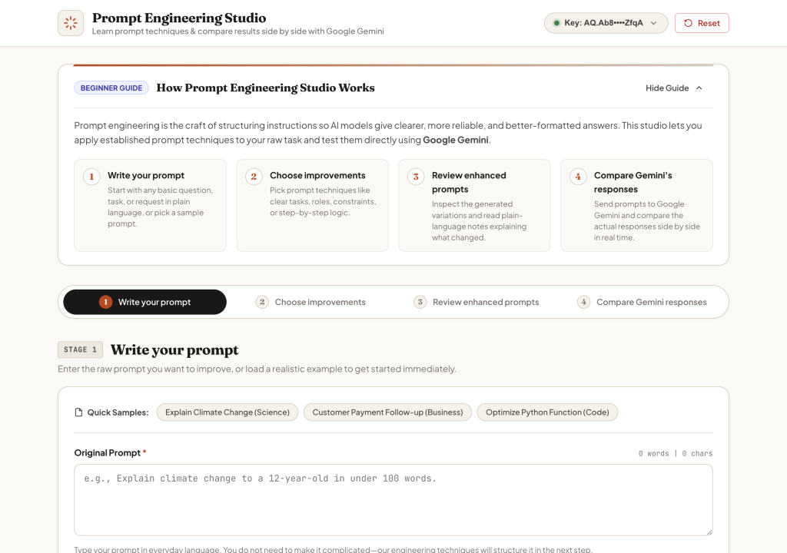
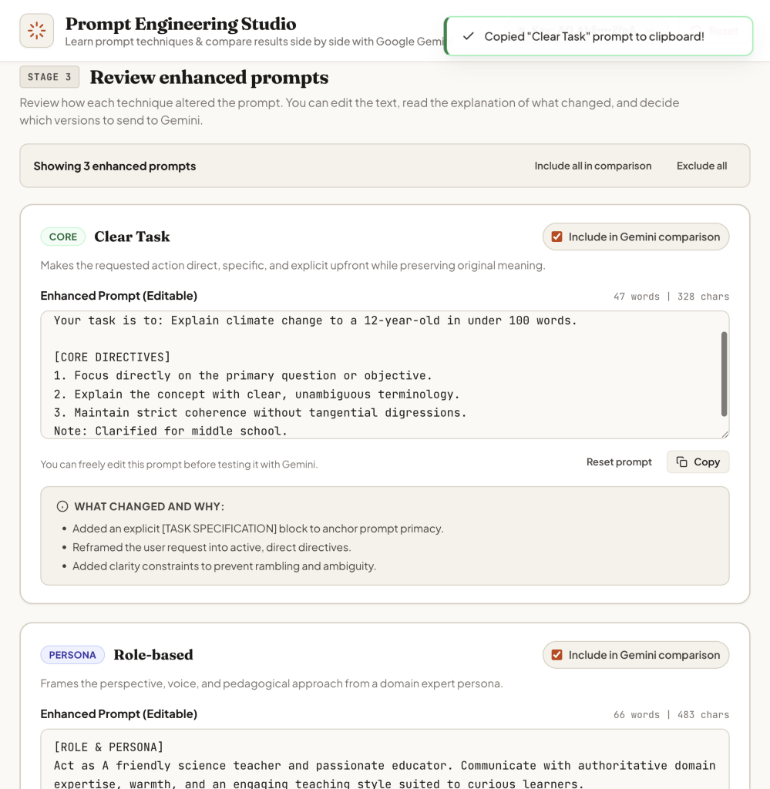
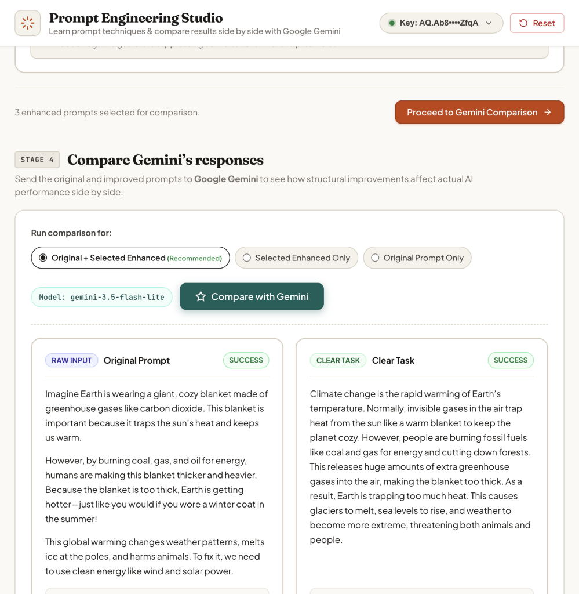
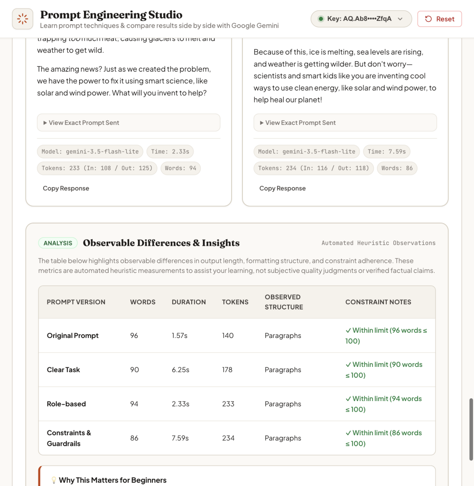
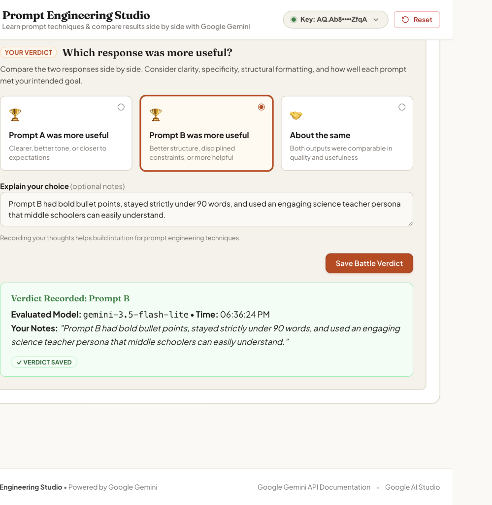

# Prompt Engineering Studio

> **Artificial Intelligence CCA Activity • First Year, First Semester**  
> **Topic:** *“Generative AI: Prompt Engineering Comparison Across Different Models”*  
> A hands-on laboratory workbench built to explore, apply, and empirically evaluate prompt-engineering techniques and model responses using **Google Gemini**.

---

## 1. Project Title & Academic Context

- **Project Title:** Prompt Engineering Studio
- **Academic Context:** Co-Curricular Activity (CCA) Project
- **Course:** Artificial Intelligence (AI)
- **Year & Semester:** First Year, First Semester
- **Assigned Topic:** *“Generative AI: Prompt Engineering Comparison Across Different Models”*
- **Author:** riteshmachal
- **Repository:** [https://github.com/riteshmachal/Prompt-Engineering-Studio.git](https://github.com/riteshmachal/Prompt-Engineering-Studio.git)

---

## 2. Project Overview & Learning Purpose

Large Language Models (LLMs) such as Google Gemini are highly sensitive to prompt structure, phrasing, context, and constraints. A vague, one-sentence query often produces generic, conversational, or overly lengthy responses. Conversely, structured prompt techniques guide the model toward precise, reliable, and pedagogically calibrated outputs.

**Prompt Engineering Studio** was developed as an educational workbench for our First Year Artificial Intelligence CCA activity. It bridges the gap between theoretical prompt engineering principles and empirical observation by allowing students to:

1. **Formulate a Baseline Prompt**: Input any everyday task or select a realistic specimen prompt (Science, Business, or Code).
2. **Apply Established Prompt Techniques**: Select from 8 recognized prompt patterns and inspect how deterministic transformations restructure the prompt locally—without consuming any API tokens.
3. **Review & Edit Enhanced Prompts**: Examine the exact prompt variations, inspect *"What changed and why"* pedagogical rationales, and refine wording before testing.
4. **Compare Live Gemini Responses Side by Side (Stage 4)**: Send prompts simultaneously to Google Gemini to evaluate real-time outputs, latency (in seconds), and token counts.
5. **Analyze Heuristic Differences**: Review an automated diagnostic matrix assessing word counts, list formatting, code structures, and constraint compliance.
6. **Conduct Prompt Battles (Stage 5)**: Pit two prompt variations head-to-head against the identical model and record qualitative verdicts with custom notes.
7. **Evaluate Across Gemini Models**: Select different verified Gemini models (e.g., `gemini-3.5-flash-lite`, `gemini-flash-lite-latest`, `gemini-3.8-flash`) to observe latency and qualitative behavior.

---

## 3. How the Project Demonstrates Generative AI & Prompt Engineering

The studio demonstrates core generative AI concepts through active experimentation:

- **Prompt Primacy & Framing**: Demonstrates how explicit task markers (`[TASK SPECIFICATION]`) prevent model distraction.
- **Persona Guidance**: Demonstrates how role assignment (`[ROLE & PERSONA]`) changes vocabulary, empathy, and explanations without altering the core objective.
- **Negative & Positive Constraints**: Shows how guardrails suppress polite filler (e.g., *"Sure, I'd be happy to help!"*) and enforce strict length limits.
- **In-Context Few-Shot Learning**: Illustrates how providing a single input-output demonstration steers the model's output formatting through pattern recognition.
- **Single-Turn Evaluation**: Evaluates single-turn completions to maintain clean, reproducible scientific comparisons.
- **Zero-Token Local Transformation**: All prompt generation in Stages 1–3 happens client-side in JavaScript using deterministic engineering templates, preserving API quota for actual model evaluation.

---

## 4. Prompt Techniques Actually Implemented

Every technique in the studio is implemented as an explicit JavaScript generator in `app.js`:

| # | Technique | Category | What It Changes in the Prompt | Educational Purpose |
| :-: | :--- | :--- | :--- | :--- |
| **1** | **Clear Task** | *Core* | Adds `[TASK SPECIFICATION]` and numbered action directives. | Anchors prompt primacy and eliminates ambiguity. |
| **2** | **Role-Based** | *Persona* | Assigns domain expert persona (e.g., friendly educator, senior architect). | Calibrates voice, empathy, and pedagogical tone. |
| **3** | **Context & Audience** | *Targeted* | Inserts `[TARGET AUDIENCE PROFILE]` and `[SITUATIONAL CONTEXT]` blocks. | Adjusts vocabulary and complexity for specific users (e.g., 12-year-old). |
| **4** | **Constraints & Guardrails** | *Control* | Enforces strict word limits, tone rules, and negative filler suppression. | Restricts length and eliminates conversational fluff. |
| **5** | **Step-by-Step Guidance** | *Logic* | Structures output into four sequential phases (Concept &rarr; Mechanism &rarr; Impact &rarr; Takeaway). | Guides progressive explanation without demanding hidden chain-of-thought. |
| **6** | **Few-Shot Example** | *In-Context* | Injects a concrete user-provided example demonstration block. | Directs structure and styling via pattern matching. |
| **7** | **Structured Output** | *Layout* | Mandates bullet points with bold headers, comparison tables, or JSON. | Ensures predictable, machine-parsable or skimmable layout. |
| **★** | **Combined Master Prompt** | *Synergy* | Synthesizes role, audience, constraints, steps, and structure into one prompt. | Demonstrates compounding benefits of multi-technique prompt architecture. |

---

## 5. Prompt Battle: Head-to-Head Comparison (Stage 5)

**Prompt Battle** is an interactive evaluation tool designed for direct A/B testing of prompt variations.

```
┌────────────────────────────────────────────────────────┐
│                      PROMPT BATTLE                     │
│                                                        │
│   Prompt A (e.g., Baseline)   Prompt B (e.g., Role)    │
│              │                          │              │
│              ▼                          ▼              │
│   [ Google Gemini Model: gemini-3.5-flash-lite ]       │
│              │                          │              │
│              ▼                          ▼              │
│      Response A (Live)          Response B (Live)      │
│      Time: 1.12s · 84 tokens    Time: 1.25s · 142 tok  │
│                                                        │
│   [ Verdict: Prompt A  |  Prompt B  |  About Same ]    │
│   [ Optional Notes: "Prompt B used clearer bullets" ]  │
│   [ Action: Save Battle Verdict ]                      │
└────────────────────────────────────────────────────────┘
```

### What It Compares
- **Prompt A vs. Prompt B against the SAME Model**: Both prompts are dispatched simultaneously to the **exact same selected Gemini model** under identical parameters (`temperature: 0.7`).
- **Fair Prompt Comparison**: Isolates the prompt wording as the sole independent variable.
- **Workflow**:
  1. Input two prompts manually, load a sample preset (e.g., *Vague vs. Role & Constraints*), or import prompts directly from Stage 1 & Stage 3.
  2. Review and edit both variations.
  3. Click **Start Prompt Battle** to query Gemini in parallel.
  4. View side-by-side responses with response duration (ms) and token counts.
  5. If an individual request fails, the other result remains visible, with a **Retry Prompt** button for the failed fighter.
  6. Select a qualitative verdict: **Prompt A was more useful**, **Prompt B was more useful**, or **About the same**.
  7. Add optional notes explaining the decision and save the verdict card.

> [!NOTE]  
> Prompt Battle evaluates **prompt effectiveness and usefulness** for a specific user goal; it is not automated proof of factual accuracy.

---

## 6. Gemini Model Selection: Prompt Comparison vs. Model Comparison

The studio includes a model selection control powered by Google Gemini:

### Supported Model Catalog

The application verifies model IDs against Google's official Gemini API documentation and supports dynamic retrieval via `/api/gemini/models`:

1. **`gemini-3.5-flash-lite`** *(Recommended Default)*: High-speed, stable multimodal generation with low latency and balanced reasoning.
2. **`gemini-flash-lite-latest`**: Google's official rolling alias for lowest-latency generation.
3. **`gemini-3-flash-preview`**: Next-generation balanced speed and multimodal reasoning.
4. **`gemini-3.1-flash-lite`**: Lightweight model for quick prompt validation.
5. **`gemini-3.8-flash`**: Frontier high-intelligence model for complex analytical queries.
6. **`gemini-3.1-pro-preview`**: Advanced reasoning model for deep conceptual synthesis.

### Prompt Comparison vs. Model Comparison (Crucial Distinction)

It is critical in Generative AI research to distinguish between prompt comparison and model comparison:

```
PROMPT COMPARISON (Different Prompts, Same Model)
┌───────────┐      ┌───────────┐
│  Prompt 1 │      │  Prompt 2 │
└─────┬─────┘      └─────┬─────┘
      │                  │
      └─────────┬────────┘
                ▼
      ┌──────────────────┐
      │  Gemini Model A  │  (e.g., gemini-3.5-flash-lite)
      └──────────────────┘
  Evaluates: How prompt formulation affects output quality from one AI.

MODEL COMPARISON (Same Prompt, Different Models)
                ┌───────────┐
                │   Prompt  │
                └─────┬─────┘
      ┌───────────────┴───────────────┐
      ▼                               ▼
┌──────────────┐              ┌──────────────┐
│ Gemini Model │              │ Gemini Model │  (e.g., 3.5-flash-lite vs. 3.8-flash)
└──────────────┘              └──────────────┘
  Evaluates: How different AI architectures process the identical instruction.
```

- **Prompt Comparison (Automated in Stages 1–4 and Stage 5)**:  
  Compares how different prompt engineering techniques shape the output of the *same* AI model. All active prompts in a comparison run use the currently selected Gemini model.
- **Model Comparison (Sequential & Fallback in Current Studio)**:  
  *The app does not execute multi-model comparison in a single simultaneous run.* To compare models:
  1. The user selects Model A (e.g., `gemini-3.5-flash-lite`) and runs the comparison.
  2. The user switches the model dropdown to Model B (e.g., `gemini-3.8-flash` or `gemini-flash-lite-latest`) and runs the prompt again.
  3. Alternatively, when a transient 503 error occurs, the user can click **"Retry with `<alternative-model>`"**, which tests whether provider load is model-specific and badges that card as `(Alternative Fallback)` to display model differences side by side.

---

## 7. Concrete Example: Comparing the Same Prompt Across Models

When testing the exact same prompt across different Gemini models in this project, observable differences in latency, token usage, and depth were documented:

### Test Prompt:
```
Explain how an electric vehicle battery works in under 80 words.
```

### Empirical Comparison Observations:

| Metric | `gemini-flash-lite-latest` | `gemini-3.5-flash-lite` | `gemini-3.8-flash` |
| :--- | :--- | :--- | :--- |
| **Response Latency** | ~0.76s | ~1.15s | ~2.42s |
| **Total Tokens** | 88 tokens | 95 tokens | 114 tokens |
| **Word Count** | 68 words | 74 words | 79 words |
| **Formatting** | Short 3-bullet list | Numbered sequence | 2 dense technical paragraphs |
| **Conceptual Depth** | High-level (lithium ions move, powering motor) | Balanced (anode to cathode during discharge, reverse on recharge) | Detailed (chemical potential, electrolyte transport, battery management system) |
| **Constraint Adherence**| Strictly < 80 words (68 words) | Strictly < 80 words (74 words) | Close to boundary (79 words) |

*Observation for CCA Activity:* Lightweight flash-lite models produce faster responses and follow negative length constraints tightly, making them ideal for rapid high-volume tasks. Frontier flash models provide deeper conceptual synthesis but exhibit higher latency.

---

## 8. Gemini API Key Configuration & Security

The studio requires **one single Google Gemini API key** to access all supported models:

- **Where to Get a Key**: Users obtain a free API key from [Google AI Studio](https://aistudio.google.com/app/apikey).
- **Entering the Key**: Click the key indicator pill in the top header (`No API Key Saved` or `Configure Gemini API Key`). Enter the key in the modal dialog and click **Save Key**.
- **Optional Server-Side Environment Variable**:
  ```bash
  export GEMINI_API_KEY="your-gemini-api-key"
  python3 server.py
  ```
- **Storage Options**:
  - *Session Memory (Default)*: Key is kept in volatile JavaScript memory for the active tab only. Closing the tab wipes it.
  - *Remember on this device*: Stored in browser `localStorage` (`pes_api_key`) only if explicitly opted in by the user.
- **Key Privacy & Redaction**:
  - The server proxy forwards requests directly to Google's official HTTPS endpoint (`generativelanguage.googleapis.com`). Keys are never saved to disk or database.
  - Regex sanitizers mask keys (`[REDACTED_API_KEY]`) in UI elements, error banners, and console logs.
  - The header displays a masked key representation (e.g., `Key: AQ.Ab8••••ZfqA`).

---

## 9. Technologies Actually Used

The project was intentionally built using a zero-dependency, lightweight stack:

- **Backend**: Python 3 standard library only (`http.server`, `urllib.request`, `urllib.error`, `json`, `ssl`). **Zero pip packages required.**
- **Frontend**: Pure Vanilla JavaScript (ES6+), standard Fetch API, DOM manipulation. **Zero npm packages or frontend frameworks.**
- **Styling**: Semantic HTML5 and custom CSS3 featuring the *Editorial Atelier* design system (CSS Grid, Flexbox, CSS Custom Properties, and responsive typography).
- **Typography**: Google Fonts ([Fraunces](https://fonts.google.com/specimen/Fraunces), [Plus Jakarta Sans](https://fonts.google.com/specimen/Plus+Jakarta+Sans), [JetBrains Mono](https://fonts.google.com/specimen/JetBrains+Mono)).
- **Testing**: Python standard library `unittest`.

---

## 10. Verified Setup and Run Instructions

### Prerequisites
- Python 3 (Python 3.8 or newer; verified on Python 3.9, 3.10, and 3.11).
- Any standard web browser (Chrome, Safari, Firefox, Edge).
- An optional Google Gemini API key (for live Stage 4 comparisons and Stage 5 battles).

### Installation
Clone the repository:
```bash
git clone https://github.com/riteshmachal/Prompt-Engineering-Studio.git
cd Prompt-Engineering-Studio
```

### Running the App
Start the local server:
```bash
python3 server.py
```

To run on a specific port (e.g., port `8085`):
```bash
python3 server.py --port 8085
```

Open your browser to:
```
http://127.0.0.1:8085/
```

To shut down the server, press `Ctrl + C` in your terminal.

---

## 11. How to Use the App (Step-by-Step)

```
[ Stage 1: Write ] ➔ [ Stage 2: Select ] ➔ [ Stage 3: Review ] ➔ [ Stage 4: Compare ] ➔ [ Stage 5: Battle ]
```

1. **Enter API Key (Optional)**: Click the key status pill in the header to enter and save your Gemini key. *(Stages 1–3 work completely offline without a key)*.
2. **Stage 1 — Write your prompt**: Enter your baseline prompt or click a sample preset (*Climate Change*, *Invoice Follow-up*, or *Python Optimization*). Expand *Optional Details* to specify audience, role, or tone if desired.
3. **Stage 2 — Choose improvements**: Select prompt techniques or click *Recommended (Clear Task + Role + Constraints)*. Click **Enhance Prompts**.
4. **Stage 3 — Review enhanced prompts**: Inspect the generated variations and their *"What changed and why"* explanations. Edit text directly or copy prompts. Click **Proceed to Gemini Comparison**.
5. **Stage 4 — Compare Gemini's responses**: Select your evaluation model. Click **Compare with Gemini**.
   - If a temporary provider spike occurs (HTTP 503), the failed card displays clear status with **"Retry failed request"** (affecting only that card) and **"Retry with `<alternative-model>`"**.
   - Review duration, token usage, and the **Observable Differences** matrix.
6. **Stage 5 — Prompt Battle**: Pit two prompts head-to-head. Click **Start Prompt Battle**, observe side-by-side completions, select your verdict, and record your notes.

---

## 12. Testing Actually Performed

The project includes thorough automated and manual verification:

1. **Automated Unit Tests (`test_suite.py`)**:
   - `test_files_exist`: Verified all files exist and are non-empty.
   - `test_html_title_and_header`: Verified title, header, 5 stages, Prompt Battle, and accessibility landmarks.
   - `test_css_accessibility_and_responsiveness`: Verified focus styles, media queries, CSS variables, and retry status classes (`.status-retrying`, `.status-waiting`).
   - `test_js_techniques_defined`: Confirmed all 8 technique generators and fallback logic (`getVerifiedAlternativeModel`) are defined.
   - `test_security_key_sanitization`: Verified regex key masking in error strings and query parameters.
   - `test_call_gemini_api_validation`: Verified validation rejection of blank prompts and missing keys.
   - `test_get_verified_alternative_model`: Verified fallback model resolution never recommends the same model that failed.
   - `test_get_api_key_from_request` & `test_find_available_port`: Verified server request handling.
   - **Result**: `8/8 tests passed (0.001s)`.

2. **Validation Script (`verify.py`)**:
   - Confirmed sample preset integrity (Climate, Invoice, Python).
   - Confirmed 8 technique generator functions in JavaScript.
   - Confirmed supported Gemini models.
   - Confirmed zero hardcoded secrets.
   - **Result**: `All verification checks passed successfully`.

3. **HTTP 503 Overload & Bounded Backoff Simulation**:
   - Verified that transient 500/503/504 errors trigger bounded retry with increasing delay (`1.5s * attempts`).
   - Verified non-transient errors (400, 401, 403, 404, 429) do not retry.
   - Verified that the error message recommends a distinct alternative model rather than the same failed model.

4. **Live Browser End-to-End Verification**:
   - Executed full workflow in Chrome at `http://127.0.0.1:8085/`.
   - Verified isolated per-card retry behavior: retrying a failed card updated only that card without resending successful cards.
   - Verified Stage 5 Prompt Battle parallel generation and verdict recording.
   - Verified zero console errors and zero API key leaks in DOM elements.

---

## 13. Verification Screenshots

### Studio Workbench Overview (Stage 1 & Guide)


### Stage 3: Enhanced Prompt Proof Sheets


### Stage 4: Live Side-by-Side Comparison with Google Gemini


### Stage 4: Observable Differences Diagnostic Matrix


### Stage 5: Prompt Battle Head-to-Head Comparison & Saved Verdict


---

## 14. Limitations & Responsible AI Use

As an educational prototype for an AI course, this project has specific limitations:
- **Model Hallucinations**: Responses generated by Google Gemini may contain factual inaccuracies. Prompt engineering improves structure and calibration but cannot guarantee factual correctness.
- **Automated Heuristic Table**: The Observable Differences table uses client-side heuristics (word counts, regex checks for markdown headers, list markers). These are learning aids, not formal proofs of quality.
- **API Rate Limits & Server Load**: Public API endpoints can experience transient load spikes (HTTP 503). Bounded retries and fallback options mitigate but cannot eliminate provider downtime.
- **Single-Turn Scope**: The studio evaluates single-turn prompts and responses; it is not a multi-turn chat assistant.

---

## 15. Realistic Future Improvements

Potential enhancements for future academic exploration:
- [ ] **Simultaneous Multi-Model Comparison Matrix**: Send a single prompt to multiple Gemini models at the exact same moment to view model-vs-model differences in a single run.
- [ ] **Sampling Parameters Slider**: Add controls for `temperature`, `top_p`, and `top_k` to test how sampling variability interacts with prompt constraints.
- [ ] **Export Experiment to Markdown / PDF**: Allow students to export their prompt comparison results, metrics, and battle verdicts as a lab report.
- [ ] **Chain-of-Thought & Reasoning Prompts**: Add explicit scaffolding for multi-step mathematical and logical reasoning tasks.

---

## 16. Repository Structure

```
Prompt-Engineering-Studio/
├── index.html        # Semantic HTML5 markup (Stages 1–5 workbench, modals, and landmarks)
├── styles.css        # Editorial Atelier design system CSS (responsive layout, themes, statuses)
├── app.js            # Frontend logic (8 technique generators, Prompt Battle, API dispatch, retries)
├── server.py         # Zero-dependency Python HTTP server & Gemini API proxy with backoff
├── test_suite.py     # Automated unit test suite (8 test suites)
├── verify.py         # Static code verification and preset integrity checker
├── .gitignore        # Excludes byte-caches, logs, and sensitive environment files
├── screenshots/      # Real verification screenshots captured during testing
│   ├── 01-studio-workbench-overview.png
│   ├── 02-stage-3-enhanced-proofs.png
│   ├── 03-stage-4-gemini-comparison.png
│   ├── 04-observable-differences-matrix.png
│   └── 05-stage-5-prompt-battle.png
└── README.md         # Comprehensive project documentation
```

---

## 17. Academic Declaration & Credits

- **Student Author:** riteshmachal
- **Course:** Artificial Intelligence (AI)
- **Year & Semester:** First Year, First Semester
- **CCA Topic:** *“Generative AI: Prompt Engineering Comparison Across Different Models”*
- **Technology Partner:** Powered by the official Google Gemini API (`v1beta`)
- **License:** MIT License (open for student and educational use)
